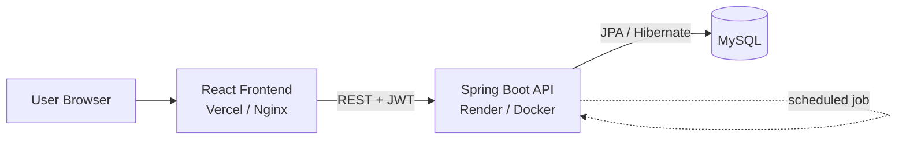
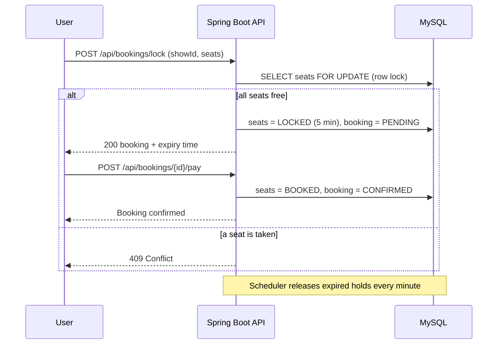
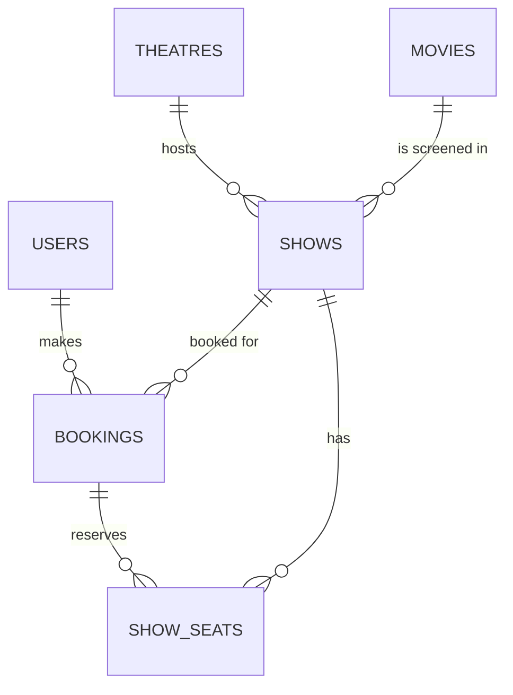

# 🎬 BookMyShow Clone

A full-stack movie ticket booking platform: browse movies, pick a show, choose seats on an interactive seat map, hold them for 5 minutes, pay, and get a booking confirmation. Built with **Java Spring Boot**, **React** and **MySQL**, containerized with **Docker** and deployed on the cloud.

🔗 **Live demo:** [bookmyshow-neon-five.vercel.app](https://bookmyshow-neon-five.vercel.app)

**video:**
<video controls src="bookmyshow-frontend/public/posters/bookmyshow.mp4" title="BookMyshow"></video>

📘 **API docs (Swagger):** `https://<your-backend-url>/swagger-ui.html`

> ⏳ The backend runs on a free tier and sleeps when idle, so the **first load can take up to a minute**. Demo login: `user@bms.com` / `user123` (or register your own account).

    

---
## ✨ Features

**For users**
- Register / login with **JWT authentication**
- Browse and search movies, filter shows by **city and date**
- Interactive **seat map** (up to 6 seats per booking)
- **5-minute seat hold** with live countdown
- Mock payment flow → booking confirmation with a unique booking ID
- **My Bookings** page with cancellation (blocked within 2 hours of showtime)

**For admins**
- Role-based **admin dashboard** to add movies, theatres and shows
- Each new show automatically generates its 80-seat layout (rows A–H, 10 seats each)

**Engineering highlights**
- **Double-booking prevention** using pessimistic row locks, optimistic versioning (`@Version`) and a unique database constraint
- **Automatic seat release:** a scheduled job frees expired holds and marks those bookings `EXPIRED`
- Layered architecture, DTO records, bean validation and a global exception handler
- Unit tests (JUnit 5 + Mockito) and a **multi-threaded concurrency test**
- Interactive **OpenAPI/Swagger** docs with JWT authorization
- **Docker Compose** setup for the whole stack; secrets kept in environment variables

---

## 🏗️ Architecture



**Backend layers:** `Controller → Service → Repository → Database`, with JWT security as a filter in front of the controllers.

### Booking flow



### Database design



---

## 🧰 Tech Stack

| Layer | Technology |
|---|---|
| Backend | Java 17+, Spring Boot 3.2, Spring Security, Spring Data JPA (Hibernate), Maven, Lombok |
| Auth | JWT (jjwt), BCrypt password hashing, role-based access (USER / ADMIN) |
| Frontend | React 18, React Router 6, Axios, Context API, Vite |
| Database | MySQL 8 (H2 in-memory for quick local runs) |
| Testing | JUnit 5, Mockito, Spring Boot Test |
| Docs | springdoc-openapi (Swagger UI) |
| DevOps | Docker, Docker Compose, Nginx, Render, Vercel |

---

## 🧠 Key Challenges & How I Solved Them

**1. Two users booking the same seat at the same time**
Checking "is the seat free?" and then saving is a classic race condition. I fixed it in three layers: a `PESSIMISTIC_WRITE` row lock when loading seats, `@Version` optimistic locking on each seat, and a unique constraint on `(show_id, seat_number)` in the database. A concurrency test starts 10 threads fighting for one seat and asserts that **exactly one** succeeds.

**2. Holding seats without blocking them forever**
Seats are `LOCKED` with an expiry time while the user pays. Expired locks are treated as free when someone else books, and a `@Scheduled` job releases them and marks the abandoned bookings `EXPIRED`. The frontend shows a live countdown.

**3. Keeping the API secure**
JWT filter authenticates each request, `/api/admin/**` requires the `ADMIN` role, and users can only read or cancel their own bookings (checked in the service layer, not just the UI).

**4. Configuration and secrets**
Database credentials and the JWT secret come from environment variables and a git-ignored `.env`, so nothing sensitive is committed. The same code runs locally, in Docker and in the cloud.

---

## 🚀 Getting Started

### Option 1: Docker (recommended, one command)

Prerequisite: [Docker Desktop](https://www.docker.com/products/docker-desktop/)

```bash
git clone https://github.com/Dikshantk29/bookmyshow.git
cd bookmyshow
cp .env.example .env        # then edit .env and set your own values
docker compose up --build
```

- App: http://localhost:3000
- API: http://localhost:8080
- Swagger: http://localhost:8080/swagger-ui.html

### Option 2: Run locally

**Prerequisites:** JDK 17+, Maven, Node 18+ (MySQL optional)

```bash
# Backend (uses in-memory H2 with demo data by default)
cd bookmyshow-backend
mvn spring-boot:run

# Frontend (new terminal)
cd bookmyshow-frontend
npm install
npm run dev                  # http://localhost:5173
```

To use MySQL instead, create the database and run the backend with the `mysql` profile:

```bash
export DB_PASSWORD=your_mysql_password
mvn spring-boot:run -Dspring-boot.run.profiles=mysql
```

### Environment variables

| Variable | Used by | Purpose |
|---|---|---|
| `DB_PASSWORD` | Docker Compose / local MySQL | Database password |
| `JWT_SECRET` / `APP_JWT_SECRET` | Backend | Secret used to sign JWT tokens (32+ chars) |
| `SPRING_DATASOURCE_URL` | Backend | JDBC URL (production) |
| `SPRING_DATASOURCE_USERNAME` / `SPRING_DATASOURCE_PASSWORD` | Backend | Database credentials (production) |
| `ADMIN_PASSWORD` | Backend | Password for the seeded admin account |
| `APP_CORS_ALLOWED_ORIGINS` | Backend | Allowed frontend URL(s), comma-separated |
| `VITE_API_URL` | Frontend (build time) | Backend API base URL |

See [`.env.example`](.env.example) for a template.

---

## 🔌 API Reference

Interactive docs are available at `/swagger-ui.html`. Protected endpoints need the header `Authorization: Bearer <token>`.

| Method | Endpoint | Auth | Description |
|---|---|---|---|
| POST | `/api/auth/register` | – | Create account, returns JWT |
| POST | `/api/auth/login` | – | Login, returns JWT |
| GET | `/api/movies?q=` | – | List / search movies |
| GET | `/api/movies/{id}` | – | Movie details |
| GET | `/api/movies/{id}/shows?city=&date=` | – | Shows for a movie |
| GET | `/api/theatres?city=` | – | List theatres |
| GET | `/api/shows/{id}/seats` | – | Seat map (AVAILABLE / LOCKED / BOOKED) |
| POST | `/api/bookings/lock` | User | Hold seats for 5 minutes |
| POST | `/api/bookings/{id}/pay` | User | Confirm booking (mock payment) |
| POST | `/api/bookings/{id}/cancel` | User | Cancel booking and release seats |
| GET | `/api/bookings/my` | User | Booking history |
| GET | `/api/bookings/{id}` | User | Single booking |
| POST | `/api/admin/movies` | Admin | Add a movie |
| POST | `/api/admin/theatres` | Admin | Add a theatre |
| POST | `/api/admin/shows` | Admin | Add a show (seats auto-generated) |

---

## 🧪 Testing

```bash
cd bookmyshow-backend
mvn test
```

- **Unit tests** (Mockito) for `BookingService`: seat locking, expired holds, seat limit, invalid seats, payment, expiry, ownership and the cancellation rule
- **Concurrency test**: 10 threads race for the same seat, exactly 1 wins

---

## 📁 Project Structure

```
bookmyshow/
├── docker-compose.yml
├── .env.example
├── bookmyshow-backend/
│   ├── Dockerfile
│   └── src/main/java/com/bookmyshow/
│       ├── config/        # Security, OpenAPI, demo data seeder
│       ├── security/      # JWT utility and filter
│       ├── controller/    # REST controllers
│       ├── service/       # Business logic
│       ├── repository/    # Spring Data JPA repositories
│       ├── entity/        # JPA entities
│       ├── dto/           # Request / response records
│       └── exception/     # Global error handling
└── bookmyshow-frontend/
    ├── Dockerfile
    ├── nginx.conf
    ├── public/posters/    # Movie poster images
    └── src/
        ├── pages/         # Home, MovieDetails, SeatSelection, Checkout, MyBookings, Admin, Login
        ├── components/    # Navbar, ProtectedRoute, AdminRoute
        ├── api.js         # Axios instance with JWT interceptor
        └── AuthContext.jsx
```

---

## ☁️ Deployment

| Part | Platform |
|---|---|
| Frontend | Vercel |
| Backend | Render (Docker) |
| Database | Managed MySQL |

---

## 🛣️ Roadmap

- [ ] Email ticket confirmation
- [ ] QR code on tickets
- [ ] Booking history filters and movie trailer links
- [ ] Real payment gateway integration (Razorpay test mode)
- [ ] Seat categories with different prices (Silver / Gold / Premium)
- [ ] CI pipeline with GitHub Actions

---

## 👤 Author

**Dikshant Koriwar** — [GitHub](https://github.com/Dikshantk29)

> Movie posters are used for demonstration purposes only. This project is not affiliated with BookMyShow.
